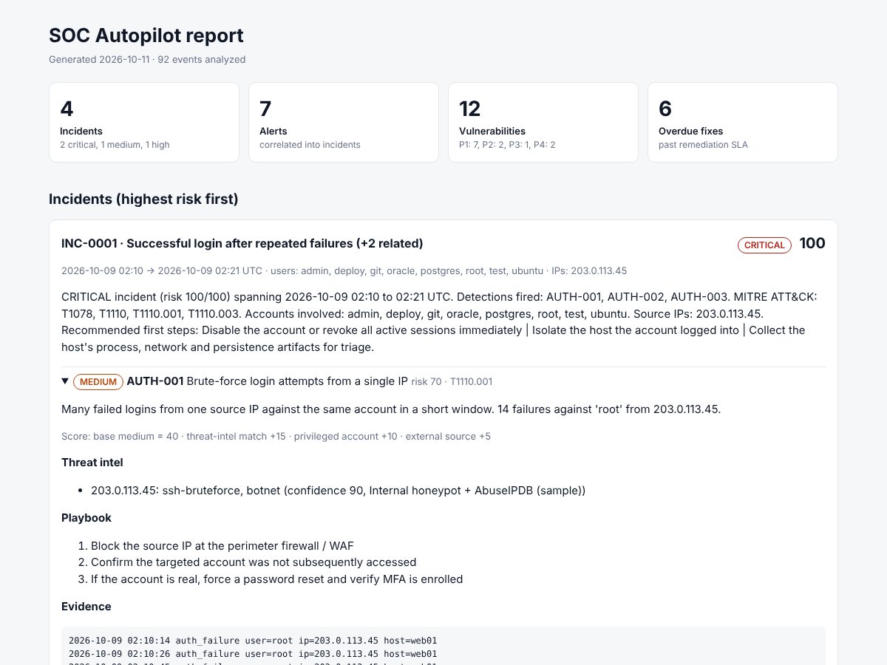
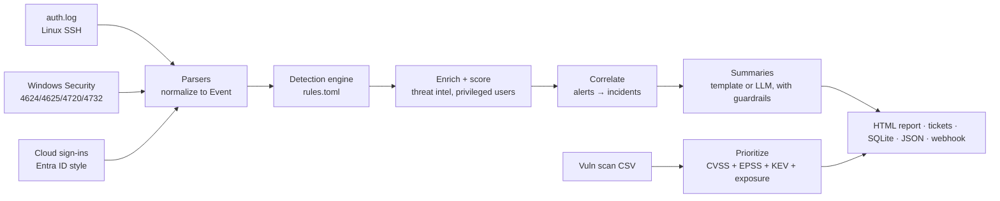

# SOC Autopilot

[](https://github.com/Kalordtis/soc-autopilot/actions/workflows/ci.yml)

**Automated detection, incident triage and risk-based vulnerability prioritization, in pure Python.**

SOC Autopilot ingests authentication logs from three different sources (Linux SSH, Windows Security events, cloud identity sign-ins), runs version-controlled detection rules mapped to MITRE ATT&CK, enriches and scores what it finds, correlates related alerts into incidents, attaches a response playbook to each one, and builds a prioritized patch queue using CISA KEV and FIRST EPSS data. Results land in an HTML report, Markdown tickets, a SQLite database you can hunt in with SQL, and an optional webhook for low-code automation tools like n8n.

No third-party dependencies. Python 3.11+.



```
$ python -m socpilot run --data data/sample --out out
[1/6] Parsed 92 events from data/sample
[2/6] 7 alerts from 6 rules
[3/6] Enriched with 4 TI indicators, correlated into 4 incidents
[4/6] Wrote template summaries; prompt-injection text flagged in 1 incident(s)
[5/6] Prioritized 12 vulnerability findings
[6/6] Outputs in out/: report.html, results.json, socpilot.db, tickets/

Top incidents:
  INC-0001  risk 100  critical  Successful login after repeated failures (+2 related)
  INC-0002  risk  98  critical  MFA fatigue / push bombing (+1 related)
  INC-0003  risk  70  medium    Brute-force login attempts from a single IP
  INC-0004  risk  60  high      New account added to a privileged group
```

## Quick start

```bash
git clone https://github.com/Kalordtis/soc-autopilot.git && cd soc-autopilot
python scripts/generate_sample_data.py          # reproducible sample dataset
python -m socpilot run --data data/sample --out out
open out/report.html                            # Windows: start out\report.html

pip install pytest && pytest -q                 # 20 tests
python -m socpilot vulns --live                 # patch queue with live CISA KEV + FIRST EPSS data
sqlite3 out/socpilot.db < sql/hunting_queries.sql
```

Optional extras:

```bash
export ANTHROPIC_API_KEY=...                    # AI-written incident summaries (see "AI security" below)
python -m socpilot run --ai

python -m socpilot run --webhook https://<your-n8n>/webhook/soc   # push high/critical incidents to n8n
python -m socpilot run --fail-on-critical       # exit code 2 on critical incidents, for schedulers/CI
```

## How it works



| Stage | File | What it does |
|---|---|---|
| Parse | `socpilot/parsers.py` | Three formats in, one normalized `Event` model out, so detections are source-agnostic |
| Detect | `socpilot/rules.toml`, `detections.py` | Detection-as-code: thresholds, MITRE mapping and playbooks live in a reviewed config file |
| Enrich | `socpilot/enrich.py` | Threat-intel matching, privileged-account and external-IP weighting, explainable 0–100 risk score |
| Correlate | `socpilot/enrich.py` | Union-find over shared users/IPs: 7 alerts become 4 incidents an analyst can actually work |
| Summarize | `socpilot/ai_summary.py` | Template summaries by default; optional LLM summaries with PII redaction and prompt-injection screening |
| Vulns | `socpilot/vulns.py` | Risk-based priority (P1–P4) and remediation due dates, live KEV/EPSS feeds supported |
| Output | `socpilot/report.py`, `store.py` | HTML report, Markdown tickets with response checklists, SQLite, JSON |
| Collect | `scripts/Export-SecurityEvents.ps1` | PowerShell exporter to run the tool on your own Windows machine's Security log |

## Detections

| ID | Detects | MITRE ATT&CK | Key logic |
|---|---|---|---|
| AUTH-001 | Brute force | T1110.001 | ≥ 8 failures, same IP + account, 10 min; overlapping windows merge into one alert |
| AUTH-002 | Password spray | T1110.003 | One IP failing against ≥ 5 distinct accounts in 15 min |
| AUTH-003 | Success after failures | T1110, T1078 | A guessing IP eventually logs in (critical) |
| IAM-001 | MFA fatigue / push bombing | T1621 | ≥ 4 denied prompts in 20 min; escalates to critical if an approval follows |
| IAM-002 | Impossible travel | T1078.004 | Haversine distance / time > 900 km/h, ignoring jumps under 500 km |
| PRIV-001 | New account → admin group | T1136.001, T1098 | Account created and added to a privileged group within 60 min |

Every rule has a true-positive **and** a true-negative test (`tests/test_pipeline.py`), and the sample data includes benign look-alikes (a typo followed by a login, a 210 km business trip, a non-privileged group change) that must not alert. That is how you tune detections without flooding analysts.

Adding a rule is usually a config change only:

```toml
[[rule]]
id = "AUTH-004"
type = "brute_force"
title = "Aggressive brute force (fast)"
severity = "high"
mitre = ["T1110.001"]
threshold = 30
window_minutes = 2
actions = ["Block at the edge immediately"]
```

## Vulnerability prioritization

CVSS says how bad a bug *could* be. The queue also asks whether it is being exploited (CISA KEV), how likely exploitation is (FIRST EPSS), and whether an attacker can reach the asset:

```
score = CVSS/10 × 30  +  EPSS × 25  +  25 if in KEV (+5 if used by ransomware)
        + 10 if internet-facing  +  0/3/7 by asset criticality
P1 ≥ 75 (7-day SLA) · P2 ≥ 55 (30 days) · P3 ≥ 35 (60 days) · P4 (90 days)
Policy override: in KEV AND internet-facing → always P1
```

Every finding carries a plain-English `rationale` explaining its score, so the result can be defended to the team that has to do the patching.

## AI security

Log fields are attacker-controlled. In the sample data, an RDP brute-force sets its NTLM `WorkstationName` to an instruction asking any AI reading the logs to mark the incident as benign. When LLM summaries are enabled, SOC Autopilot applies three controls:

1. **Prompt-injection screening:** instruction-like text in evidence is removed before the model sees it and flagged in the report for a human.
2. **PII minimization:** usernames and emails are replaced with consistent pseudonyms (`USER_1`) and restored locally after the response.
3. **Data/instruction separation:** logs travel inside `<untrusted_logs>` tags and the system prompt forbids following instructions found there or lowering severity because of them.

If the API is unreachable, the pipeline falls back to the deterministic summary instead of failing.

## Run it on your own machine

```powershell
# Windows, elevated PowerShell
.\scripts\Export-SecurityEvents.ps1 -Hours 48 -OutFile data\mine\windows_events.json
python -m socpilot run --data data\mine --out out-mine
```

On Linux, copy `/var/log/auth.log` into a folder and point `--data` at it.

## SQL hunting

`sql/hunting_queries.sql` includes pivots an analyst would actually run: top attacking IPs, everything one IP did across all sources, successes that followed failures, noisiest rules (for tuning), overdue P1/P2 patches, and per-host remediation workload.

## Sample data

`scripts/generate_sample_data.py` builds a seeded dataset with four planted attack scenarios plus benign noise. Attacker IPs come from RFC 5737 documentation ranges and accounts use `contoso.example`, so nothing points at real people or hosts. CVEs are real; their KEV/EPSS values are a point-in-time sample. Use `--live` for current values.

## Roadmap

- [ ] AWS CloudTrail parser plus rules for root-account use and `StopLogging` (cloud security)
- [ ] Map detections and controls to NIST CSF 2.0 for a compliance coverage view (GRC)
- [ ] Sigma rule import, so community detections can run unmodified
- [ ] Sentinel / KQL versions of each rule for SC-200 practice
- [ ] Phishing-awareness module: score reported emails (SPF/DKIM/DMARC, lookalike domains)

## License

MIT
